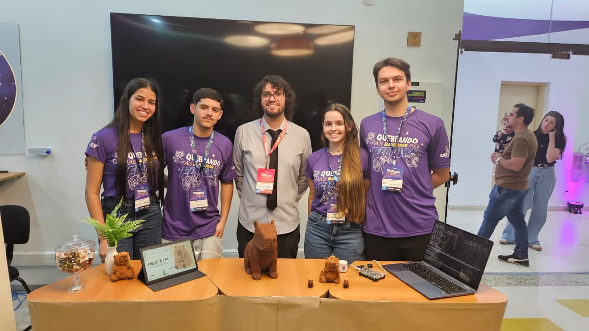
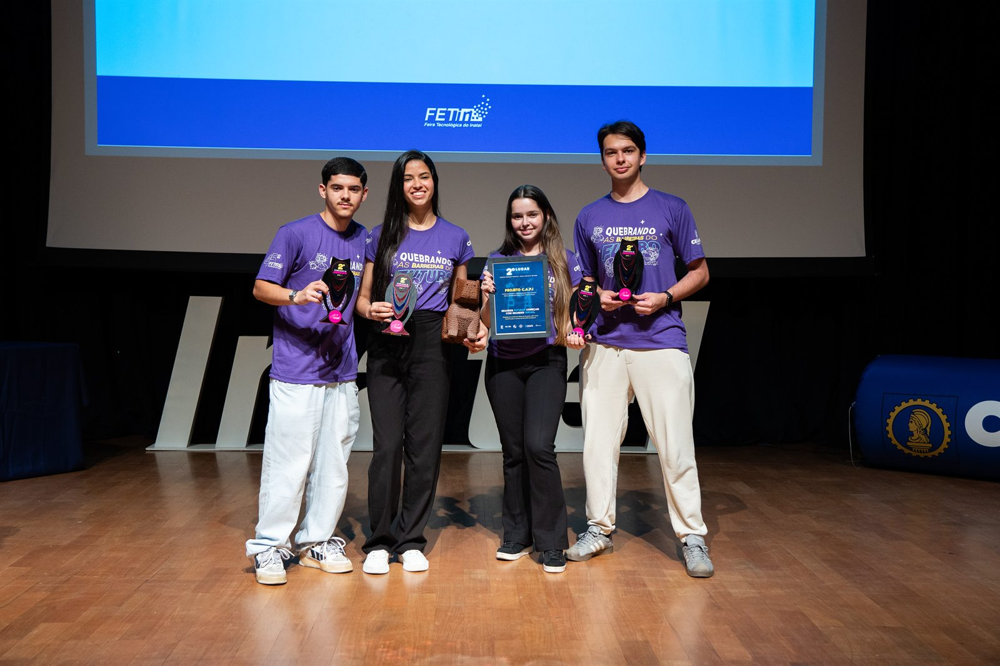
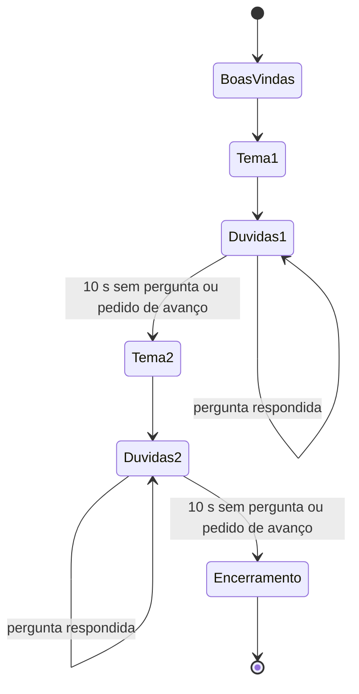
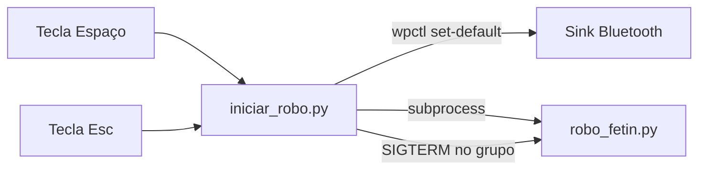

# CAPI — Condutor Autônomo de Passeios Interativos

**Robô de estande que apresenta a história de Sinhá Moreira e conversa com o público em tempo real.**


> Projeto desenvolvido e apresentado na **FETIN 2026**, em Santa Rita do Sapucaí (MG), onde conquistou o **2º lugar em Viabilidade de Mercado**; também recebeu o **2º lugar no Desafio Inovação Turística**, promovido pela **Prefeitura de Santa Rita do Sapucaí**.
> Este repositório é mantido como **documentação técnica e estudo de caso**: as chaves de API foram revogadas e o sistema **não está mais em operação**.




[🌐 Página do projeto](https://gazzolam.github.io/Projeto-C.A.P.I/) · [🔊 Ouça uma amostra da voz do robô](https://gazzolam.github.io/Projeto-C.A.P.I/docs/audio/amostra_intro.mp3)

---

## Sobre o projeto

O CAPI (Condutor Autônomo de Passeios Interativos) é um robô-guia criado para receber visitantes e contar a história de **Sinhá Moreira**, personagem central da transformação de Santa Rita do Sapucaí no Vale da Eletrônica. O nome é uma referência à capivara, mascote da cidade.

O robô não é um chatbot solto: ele segue um **roteiro de apresentação em dois blocos**, abre espaço para dúvidas do público depois de cada bloco e só então encerra. A conversa é ancorada em uma base de conhecimento histórica, com instruções rígidas para não inventar informação.

## Premiações

| Premiação | Organização | Categoria | Resultado |
|---|---|---|---|
| **FETIN 2026** | FETIN | Viabilidade de Mercado | 🥈 2º lugar |
| **Desafio Inovação Turística** | Prefeitura de Santa Rita do Sapucaí | Inovação Turística | 🥈 2º lugar |



*Equipe do CAPI na premiação da FETIN 2026.*

## Como funcionava


O roteiro é uma máquina de estados com duas pausas para perguntas:



Um processo separado (`iniciar_robo.py`) fica aguardando o operador:



## Stack

| Camada | Tecnologia |
|---|---|
| Execução | Raspberry Pi + Raspberry Pi OS (Python 3, venv `env_voz`) |
| Entrada de voz | Microfone + `SpeechRecognition` (Google Web Speech API, `pt-BR`) |
| Inteligência | API da DeepSeek (`deepseek-chat`) com prompt de regras + base de conhecimento |
| Saída de voz | `edge-tts` (voz `pt-BR-AntonioNeural`) + `mpg123` |
| Áudio | PulseAudio/PipeWire → caixa de som Bluetooth |
| Orquestração | `iniciar_robo.py` — watcher de teclado via `/dev/input` |

## Decisões de projeto

- **Roteiro pré-gravado em cache.** As falas fixas (boas-vindas, dois temas, encerramento, transições) são sintetizadas uma vez e salvas como MP3. No palco, tocar um arquivo é instantâneo — sem latência de TTS e sem depender da internet para o script principal.
- **Áudio temporário em `/dev/shm`.** Respostas geradas na hora vão para a memória RAM, evitando desgaste do cartão SD e reduzindo a latência.
- **Heurística de avanço.** Frases curtas como "não", "pode seguir", "sem dúvida" e "era só isso" encerram a sessão de perguntas, sem esperar os 10 segundos. Exceções como "não entendi" e "não sei" são tratadas como dúvida.
- **Janela de 10 segundos por pergunta.** Se ninguém falar, a apresentação segue sozinha — importante em um estande com público variável.
- **Silenciamento do ALSA.** Os avisos do `libasound` eram redirecionados para não poluir o terminal e não atrapalhar a captura do microfone.
- **Watcher com lock.** `flock` impede duas instâncias simultâneas; `Esc` encerra o grupo de processos da apresentação.
- **Resiliência no LLM.** Até três tentativas com intervalo de 2 segundos antes de desistir, para absorver instabilidades da rede do evento.

## Estrutura do repositório

```
.
├── robo_fetin.py          # apresentação, voz, escuta e integração com a IA
├── iniciar_robo.py        # watcher: Espaço inicia, Esc encerra
├── apresentacao.txt       # boas-vindas
├── tema1.txt              # bloco 1 do roteiro
├── tema2.txt              # bloco 2 do roteiro
├── encerramento.txt       # fala final
├── regras.txt             # instruções de comportamento da IA
├── conhecimento.txt       # base de conhecimento histórica
├── requirements.txt       # dependências (documentação)
├── .env.example           # modelo de configuração da chave
├── index.html             # landing page publicada no GitHub Pages
├── .nojekyll              # desativa o processamento Jekyll
├── docs/
│   ├── ARQUITETURA.md     # detalhamento técnico
│   ├── audio/             # amostra da voz
│   └── midia/             # fotos do estande e da premiação
└── LICENSE
```

## Como rodava

> **Aviso:** o projeto dependia de hardware (Raspberry Pi, microfone e caixa Bluetooth), de internet e de uma chave da DeepSeek. A chave usada no evento foi revogada, então os passos abaixo são **documentação histórica**.

```bash
# 1. Dependências de sistema
sudo apt install portaudio19-dev mpg123 wireplumber

# 2. Ambiente Python
python3 -m venv env_voz
source env_voz/bin/activate
pip install -r requirements.txt

# 3. Configuração
cp .env.example .env
# edite o .env e informe DEEPSEEK_API_KEY

# 4. Execução
python3 iniciar_robo.py   # Espaço inicia a apresentação, Esc encerra
```

O watcher ajustava o sink padrão do PipeWire para a caixa Bluetooth antes de iniciar a apresentação. Os caminhos da instalação (pasta do projeto e venv `env_voz`) estavam fixos no topo de `iniciar_robo.py`; a chave vinha do `.env` local, fora do versionamento.

## Segurança

- A chave da DeepSeek era lida de `DEEPSEEK_API_KEY` (variável de ambiente ou `.env`).
- O `.env` sempre esteve no `.gitignore` e **nunca entrou no histórico do git** — verificado commit a commit.
- A chave usada no evento foi **revogada** após a apresentação.
- O repositório não contém tokens, senhas ou credenciais.

## Resultados

O CAPI operou no estande da FETIN apresentando o roteiro completo e respondendo perguntas espontâneas do público, incluindo perguntas fora do roteiro — que eram respondidas apenas quando estavam na base de conhecimento. O trabalho também recebeu duas premiações, detalhadas na seção [Premiações](#premiações).


## Limitações e o que eu faria diferente

Este projeto foi feito para funcionar no dia do evento, e essa prioridade aparece no código. Com mais tempo, eu mudaria:

- **Timeout nas chamadas de API** — hoje uma rede instável pode travar a apresentação indefinidamente.
- **`subprocess` no lugar de `os.system`** para o TTS, eliminando qualquer risco de injeção de shell via texto gerado pela IA.
- **Invalidação de cache por hash do texto** — se o roteiro fosse editado, o MP3 antigo continuaria sendo tocado.
- **Fallback offline** de voz (Piper, avaliado mas não adotado) e de reconhecimento (Vosk/Whisper), para reduzir a dependência de internet.
- **Sink de áudio dinâmico**, em vez de MAC fixo da caixa Bluetooth.
- **Histórico de conversa** no LLM, para o robô lembrar o que acabou de responder.
- **Logs estruturados** em arquivo, para diagnosticar falhas depois do evento.

## Créditos

- **Conteúdo histórico:** pesquisa sobre a vida de Luzia Rennó Moreira, a Sinhá Moreira, e a criação da ETE FMC. A base corrige um erro comum: o Inatel **não** foi fundado por ela, mas pelas condições educacionais que ela ajudou a criar.
- **Voz:** `pt-BR-AntonioNeural`, via edge-tts.
- **APIs:** Google Web Speech (reconhecimento) e DeepSeek (geração de respostas).

## Autoria

**Matheus Gazzola** — [@GazzolaM](https://github.com/GazzolaM)

https://www.linkedin.com/in/matheus-gazzola/

## Licença

Código sob licença [MIT](LICENSE). Os textos do roteiro e a base de conhecimento são conteúdo histórico e não estão cobertos pela licença.

<details>
<summary>Resumo em inglês</summary>

CAPI is a Raspberry Pi robot guide built for FETIN 2026. It presents a scripted two-part talk about Sinhá Moreira, a key figure in Santa Rita do Sapucaí's transformation into Brazil's "Electronics Valley", and answers audience questions using speech recognition (Google STT), the DeepSeek API for grounded answers, and edge-tts for voice output. The project won 2nd place in Market Viability at FETIN 2026 and 2nd place in the Tourism Innovation Challenge run by the Santa Rita do Sapucaí city government. The repository is kept as documentation; the API keys were revoked and the system is no longer running.

</details>
