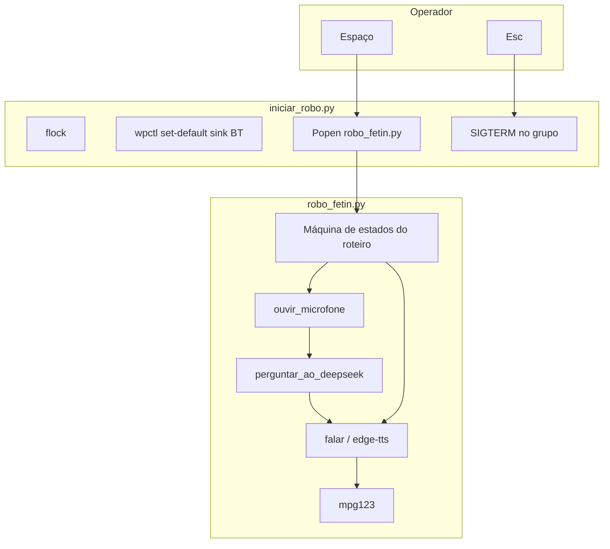
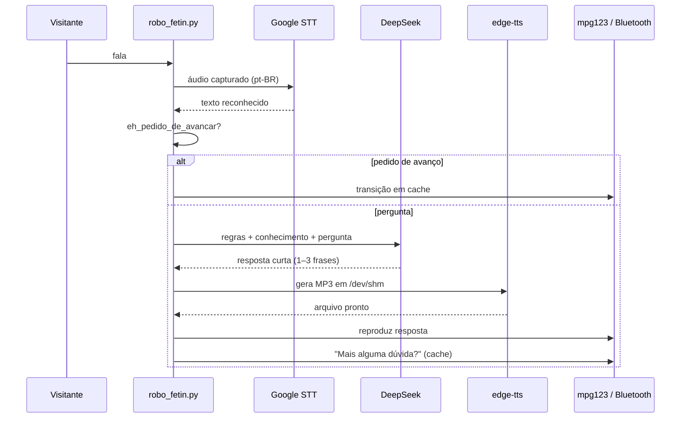
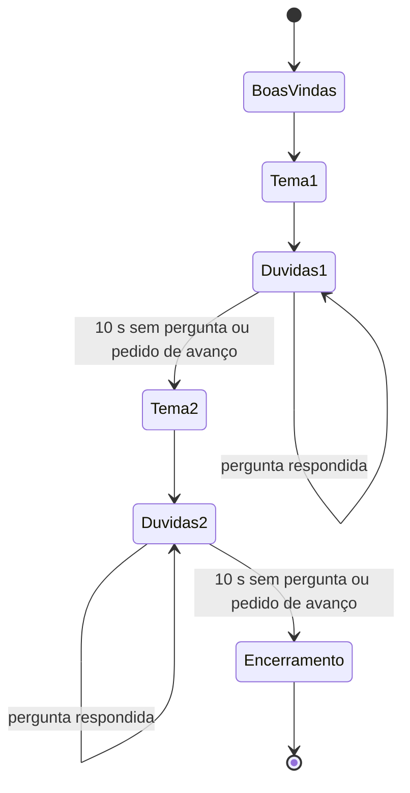

# Arquitetura do CAPI

Documento técnico de referência. O projeto não está mais em operação; este texto descreve como o sistema funcionava na versão apresentada na FETIN 2026.

## Visão geral

O sistema tinha dois processos:

1. **`iniciar_robo.py` (watcher)** — ficava em segundo plano lendo eventos de teclado diretamente de `/dev/input`. Ao detectar **Espaço**, ajustava o sink de áudio para a caixa Bluetooth e iniciava a apresentação em um novo grupo de processos. Ao detectar **Esc**, encerrava o grupo com `SIGTERM`. Um `flock` em `/tmp/capi_robo_watcher.lock` impedia duas instâncias simultâneas.
2. **`robo_fetin.py` (apresentação)** — executava o roteiro, capturava perguntas, consultava a IA e sintetizava/tocava as respostas.

## Módulos e responsabilidades

| Componente | Responsabilidade |
|---|---|
| `iniciar_robo.py` | Escutar teclas, preparar o sink de áudio, iniciar/encerrar a apresentação, garantir instância única |
| `robo_fetin.py` | Roteiro, captura de voz, consulta à IA, síntese e reprodução de áudio |
| `apresentacao.txt` / `tema1.txt` / `tema2.txt` / `encerramento.txt` | Falas fixas do roteiro |
| `regras.txt` | Instruções de comportamento enviadas como system prompt |
| `conhecimento.txt` | Base de conhecimento histórica usada como contexto |

Funções principais de `robo_fetin.py`:

- `falar(texto, nome_arquivo, salvar_cache)` — gera o MP3 com `edge-tts` e reproduz com `mpg123`; usa cache para falas fixas e `/dev/shm` para respostas dinâmicas.
- `ouvir_microfone(tempo_espera)` — ajusta o ruído ambiente, escuta até 15 s de fala e converte com Google STT em `pt-BR`.
- `perguntar_ao_deepseek(regras, conhecimento, pergunta)` — monta o prompt, chama a API e limpa a resposta para leitura em voz alta.
- `sessao_de_duvidas(...)` — janela de 10 s para perguntas, com detecção de pedido de avanço.
- `eh_pedido_de_avancar(texto)` — heurística de frases curtas ("não", "pode seguir", "sem dúvida") com lista de exceções ("não entendi", "não sei").

## Fluxo de uma pergunta

## Áudio

- **Síntese:** `edge-tts` com a voz `pt-BR-AntonioNeural`, chamado pela CLI.
- **Reprodução:** `mpg123 -q -o pulse <arquivo>`. Se o retorno não fosse zero, havia fallback para `mpg123 -q -a hw:2,0`.
- **Cache:** falas do roteiro ficam como `cache_*.mp3` no diretório do projeto. A primeira execução gera o arquivo; as seguintes apenas tocam.
- **Temporários:** respostas dinâmicas vão para `/dev/shm/fala_ia.mp3` e são apagadas depois da reprodução.
- **Sink Bluetooth:** o watcher executava `wpctl set-default bluez_output.<MAC>.1` antes de iniciar a apresentação.

Arquivos de cache do roteiro:

| Arquivo | Uso |
|---|---|
| `cache_intro.mp3` | boas-vindas |
| `cache_tema1.mp3` | bloco 1 |
| `cache_tema2.mp3` | bloco 2 |
| `cache_fim.mp3` | encerramento |
| `cache_pergunta_duvida.mp3` | "Alguém tem alguma dúvida?" |
| `cache_continuar.mp3` | transição após o bloco 1 |
| `cache_mais_duvidas.mp3` | "Mais alguma dúvida?" |
| `cache_nao_entendi.mp3` | fallback de reconhecimento |

## Máquina de estados do roteiro

A janela de espera é reiniciada a cada pergunta respondida (`TEMPO_SEM_PERGUNTA = 10`). O operador pode encerrar a qualquer momento com **Esc**, independentemente do estado do roteiro.

## Resiliência

- **LLM:** até 3 tentativas com 2 s de intervalo; ao esgotar, o robô fala uma mensagem de indisponibilidade.
- **Microfone:** `WaitTimeoutError` (ninguém falou) retorna string vazia e a apresentação segue. `UnknownValueError` toca a fala `cache_nao_entendi.mp3`.
- **ALSA:** os erros do `libasound` eram silenciados com um handler em C via `ctypes`, para não poluir o terminal nem interferir no microfone.
- **Codificação:** `stdin` forçado para UTF-8, para funcionar também via SSH.

## Limitações conhecidas

- Sem `timeout` nas chamadas HTTP — uma rede instável podia travar a apresentação.
- TTS via `os.system` com o texto entre aspas — risco de injeção de shell a partir de texto gerado pela IA.
- Cache sem invalidação por hash — editar um `.txt` não regenerava o áudio correspondente.
- Sink Bluetooth fixo por MAC — trocar a caixa exigia editar o código.
- Dependência total de internet (STT, LLM e TTS).
- Sem histórico de conversa: cada pergunta era respondida isoladamente.
- Sem logs em arquivo.

## Possíveis evoluções

- Piper para TTS offline e Vosk/Whisper para STT offline.
- `subprocess`/API Python do `edge-tts` no lugar da CLI.
- Cache com hash do texto e limpeza automática de arquivos órfãos.
- Detecção dinâmica do sink de áudio.
- Histórico de conversa com janela curta no LLM.
- Testes unitários para a heurística de avanço e para o parser da resposta da API.
